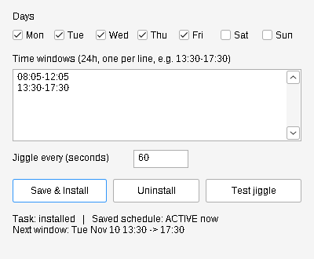

# mousejiggler-cli

Headless, scheduled "zen" mouse jiggler for Windows. Wakes your monitors and keeps them on during set hours. The cursor never moves, there's no window and no tray icon, and nothing changes about how you use the PC.

Default schedule: **Mon–Fri, 08:05–12:05 and 13:30–17:30**.

Double-click `jiggler.exe` to open a settings window. Everything in it can also be done from the command line, so you can script it.



## How it works

- **Zen jiggle:** sends a `SendInput` relative mouse move of `0,0`. Windows counts it as user input, which resets the idle timer and wakes sleeping displays, but the pointer stays where it is. This is the same approach as the "zen jiggle" mode in arkane-systems/mousejiggler.
- **Keep-awake:** inside a window it also holds `SetThreadExecutionState(ES_DISPLAY_REQUIRED | ES_SYSTEM_REQUIRED)`. Outside a window it drops that request, so normal sleep and display-off settings apply again.
- **Scheduling:** `install` registers one Task Scheduler task. It starts the loop at logon and fires again at each window start on scheduled days, with **Wake to run** turned on. If the PC is asleep at 08:05 it wakes up. If the loop is already running, the extra trigger does nothing.
- **Headless:** the exe is built as a GUI-subsystem binary, so the scheduled task never flashes a console window. When you run it from a terminal, it attaches to that terminal so you can see its output.

## Install

1. Download `jiggler-windows-amd64.exe` (or `arm64`) from the repo's **Actions → build → Artifacts**, or from Releases if a `v*` tag exists. You can also build it yourself:
   ```
   GOOS=windows GOARCH=amd64 go build -trimpath -ldflags "-H windowsgui -s -w" -o jiggler.exe .
   ```
2. Rename the file to `jiggler.exe`, then either:
   - **GUI:** double-click it, set the days, windows and interval, then click **Save & Install**.
   - **CLI** (no admin needed): `.\jiggler.exe install`

   Either way, it copies the exe to `%LOCALAPPDATA%\Programs\mousejiggler-cli\jiggler.exe`, saves the config, registers the `MouseJigglerCLI` task and (re)starts it.

## Automating it

The GUI and the CLI share one config file: `%LOCALAPPDATA%\mousejiggler-cli\config.json`. Any flag you leave out keeps its saved value. Re-running `install` applies changes.

```powershell
# Change only the afternoon window (passing --window replaces all saved windows)
jiggler install --window 08:05-12:05 --window 13:00-17:00

# Change only the days
jiggler install --days Mon-Thu

# Machine-readable state
jiggler status --json | ConvertFrom-Json

# Take a day off (schedule untouched, no reinstall)
jiggler pause                         # rest of today
jiggler pause --for 3h
jiggler pause --days 2                # today + tomorrow
jiggler pause --until 13:30           # today (or tomorrow if already past)
jiggler pause --until 2026-11-16      # back on Monday
jiggler resume
jiggler toggle                        # resume if paused, else pause rest of today

# One word for scripts/buttons: ACTIVE | IDLE | PAUSED | OFF
jiggler status --short
```

Times use the **24h** clock. `--days` accepts `Mon-Fri`, `Mon,Wed,Fri`, `Sat-Sun` or `all`. Set `MOUSEJIGGLER_HOME` to use a different config/log directory.

## Commands

| Command | What it does |
|---|---|
| *(none)* / `gui` | Opens the settings window |
| `install [flags]` | Saves the settings, copies the exe, registers and (re)starts the scheduled task |
| `uninstall` | Stops and deletes the task |
| `status [--json \| --short]` | Shows the saved schedule, whether it's active now, the next window and the task state |
| `pause [--for D \| --days N \| --until T]` | Pauses jiggling (default: rest of today). The schedule is untouched and it resumes on its own |
| `resume` | Cancels a pause |
| `toggle` | Resumes if paused, otherwise pauses for the rest of today |
| `once` | Sends one zen jiggle immediately (quick test) |
| `run [flags]` | Runs the loop in the foreground (this is what the task runs) |

Log: `%LOCALAPPDATA%\mousejiggler-cli\jiggler.log`. It records window enter/exit and errors only, and it truncates itself after 1 MB.

## Stream Deck plugin

Install `mousejiggler.streamDeckPlugin` from the release or the build artifacts by double-clicking it. Then drag **Mouse Jiggler → Jiggler Toggle** onto a key.

- **Press:** pauses for the rest of today, or resumes if it's paused.
- **The key shows the live state:** green with `ACTIVE` or `IDLE` (outside your hours), gray with `PAUSED today` or `PAUSED Mon 00:00`, or gray with `OFF` if the scheduled task isn't installed.
- The plugin reads the same `pause.json` and `config.json` as the CLI and GUI, every 3 seconds. The key stays accurate when you pause from the command line or the GUI, or when a pause expires.
- The plugin uses its own copy of `jiggler.exe`. Install the jiggler itself (`jiggler install` or the GUI) as usual. Without it the key shows `OFF`.

To use plain launcher keys instead of the plugin, point Stream Deck's **System → Open** action at a shortcut. **Open** doesn't reliably pass arguments, so create the shortcut first:
```powershell
$sh = New-Object -ComObject WScript.Shell
$l = $sh.CreateShortcut("$env:LOCALAPPDATA\mousejiggler-cli\jiggler-toggle.lnk")
$l.TargetPath = "$env:LOCALAPPDATA\Programs\mousejiggler-cli\jiggler.exe"; $l.Arguments = 'toggle'; $l.Save()
```

## Caveats

- **Waking from sleep** needs wake timers enabled: Control Panel → Power Options → Change plan settings → Advanced → Sleep → *Allow wake timers* → **Enable**. Some corporate images turn this off.
- **Locked workstation:** Windows won't let a user process inject input into the lock screen, so `SendInput` fails while the PC is locked (this shows up in the log). The keep-awake request still applies. In practice: if the session is unlocked when a window starts, the displays stay on for the whole window. If Windows locked overnight, the monitors may not wake until you touch the keyboard. Group Policy can force a lock-screen timeout, and no user-level tool can override that.
- The task runs only while you're logged in (it needs your desktop session). A reboot plus auto-logon, or simply logging in, starts it again.
- A pause lives in `pause.json` next to the config. The running task checks it every 5 seconds, so pausing and resuming take effect right away without a reinstall.
- Edits only apply when you click **Save & Install** or run `install`. Editing `config.json` by hand doesn't update the wake-up triggers.
